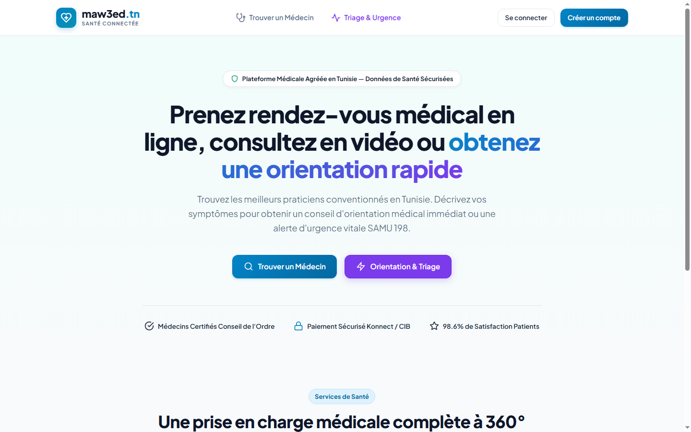
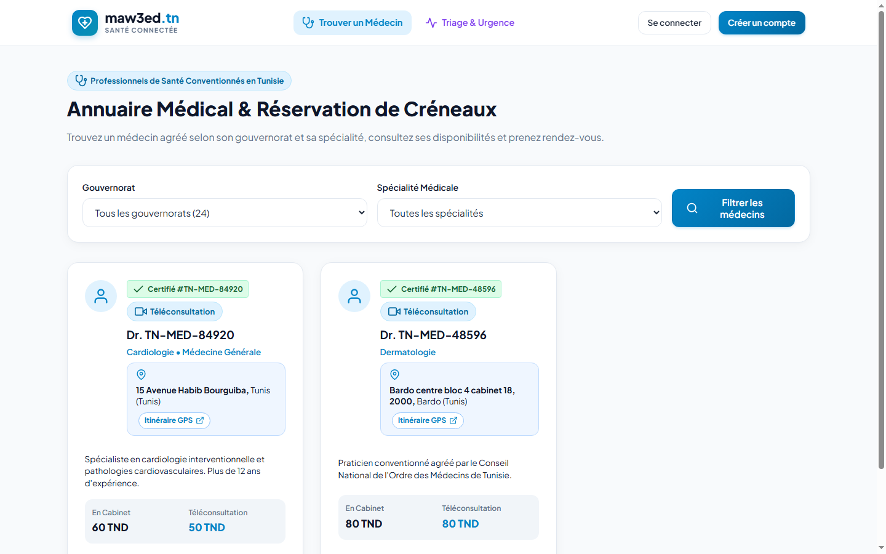
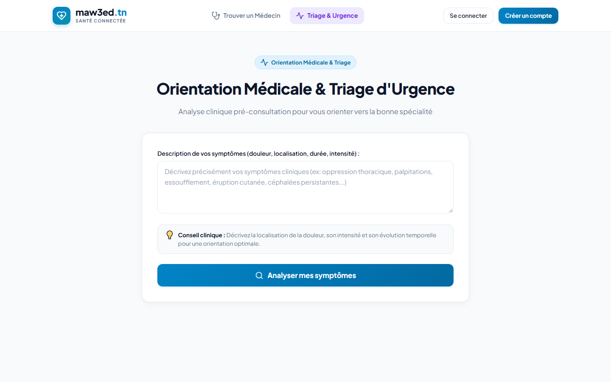
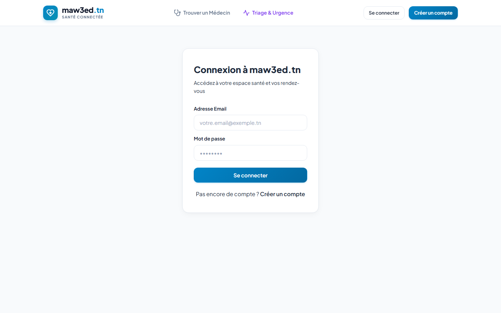

# Maw3ed.tn - Plateforme de Téléconsultation & Prise de Rendez-vous

[](https://github.com/yassinos786/maw3ed.tn/actions/workflows/ci-cd.yml)
[](https://yassinos786.github.io/maw3ed.tn/)
[](https://spring.io/)
[](https://angular.dev/)
[](https://fastapi.tiangolo.com/)
[](https://www.mongodb.com/)
[](https://www.docker.com/)
[](LICENSE)

Plateforme de prise de rendez-vous médicaux en ligne, de téléconsultation sécurisée (WebRTC / Jitsi Meet) et d'orientation médicale (Triage des symptômes & détection d'urgence vitale SAMU 198).

---

## Aperçu des Interfaces

| Page d'Accueil | Annuaire Médical |
| :---: | :---: |
|  |  |

| Orientation Médicale & Triage SAMU 198 | Connexion Sécurisée (JWT) |
| :---: | :---: |
|  |  |

---

## DevOps & Pipeline CI/CD (GitHub Actions)

Le projet intègre une chaîne CI/CD configurée via **GitHub Actions** (`.github/workflows/ci-cd.yml`) :

```
                        [ Git Push / Pull Request ]
                                     |
         +---------------------------+---------------------------+
         v                           v                           v
    Backend CI                Triage Service CI             Frontend CI
(Spring Boot 3 + Java 21)    (FastAPI + Python 3.11)    (Angular 22 + Node 24)
  - Maven Clean Test           - Pip Install Requirements - Npm Install
  - Mockito Unit Tests         - Pytest Unit Tests        - Angular Prod Build
  - Maven Package JAR          - Syntax & Lint Check      - Artifact Upload
         |                           |                           |
         +---------------------------+---------------------------+
                                     v
                        Docker Compose Validation
                                     v
                    CD : GitHub Pages Deployment
                 (Application Frontend déployée en direct)
```

### Avantages de la chaîne CI/CD :
1. **Intégration Continue (CI)** : À chaque `git push`, GitHub installe les environnements, exécute les tests unitaires et compile les services indépendamment. Si une erreur de syntaxe ou un test échoue, le pipeline bloque et alerte immédiatement.
2. **Déploiement Continu (CD)** : Dès que les tests sont validés sur la branche principale, le Frontend Angular est automatiquement compilé et déployé sur **GitHub Pages** : [https://yassinos786.github.io/maw3ed.tn/](https://yassinos786.github.io/maw3ed.tn/).

---

## Architecture Globale & Stack Technique

* **Backend** : Spring Boot 3 (Java 21 LTS), Spring Security 6 avec JWT, Spring Data MongoDB, WebSocket (STOMP), RestTemplate résilient avec fallback automatique.
* **Microservice Triage & Orientation (Python)** : FastAPI + Uvicorn (Port 8000), Pydantic v2, moteur d'analyse et de détection d'urgence vitale (Français, Derja, Anglais).
* **Base de données** : MongoDB (indexation géospatiale `2dsphere` et collections `triage_logs`, `payments`, `appointments`, `audit_logs`...).
* **Frontend** : Angular (Standalone Components, Signals, RxJS, Lazy Loading).
* **Téléconsultation & Paiement** : WebRTC / Jitsi Meet (salle verrouillée jusqu'au paiement validé) et suivi des règlements (Espèces sur place & paiement en ligne).

---

## Structure du Projet

```
maw3ed.tn/
├── .github/workflows/
│   └── ci-cd.yml                  <-- Pipeline CI/CD GitHub Actions automatisé
│
├── triage_service/                <-- Microservice de Triage Python FastAPI (Port 8000)
│   ├── main.py                    <-- Endpoints (/api/v1/triage/analyze, /health, /metrics)
│   ├── test_main.py               <-- Tests unitaires Pytest
│   ├── requirements.txt           <-- FastAPI, Uvicorn, Pydantic, Pytest
│   └── Dockerfile                 <-- Image Docker autonome
│
├── backend/                       <-- Application Spring Boot 3 (Port 8080)
│   ├── src/main/java/tn/maw3ed/api/
│   │   ├── core/                  <-- Configuration (Security, Mongo, WebSocket, Swagger, DataInitializer)
│   │   ├── security/              <-- JWT JJWT Provider, Filtres & RBAC
│   │   └── modules/
│   │       ├── iam/               <-- AuthController, Users, Tokens
│   │       ├── doctor/            <-- DoctorController, Profils, Recherche 2dsphere, Honoraires
│   │       ├── appointment/       <-- AppointmentController, Réservation atomique anti-collision
│   │       ├── triage/            <-- TriageController, PythonTriageClient & TriageLog MongoDB
│   │       ├── payment/           <-- PaymentController, Checkout & Reçus
│   │       ├── teleconsultation/  <-- Visioconférence WebRTC / Jitsi Meet
│   │       └── admin/             <-- Back-Office, Validation des praticiens, KPI & Revenus
│   └── pom.xml
│
├── frontend/                      <-- Application Angular Standalone (Port 4200)
│   ├── src/app/
│   │   ├── core/                  <-- Modèles TS, Services (Auth, Doctor, Appointment, Triage, Payment)
│   │   ├── shared/                <-- Navbar responsive & PaymentModalComponent
│   │   └── features/
│   │       ├── home/              <-- Page d'accueil & recherche rapide
│   │       ├── triage/            <-- Module de Triage & Alerte SAMU 198
│   │       ├── doctors/           <-- Annuaire, tarifs des consultations & réservation directe
│   │       ├── appointments/      <-- Mes RDV, itinéraire GPS, paiement & accès téléconsultation
│   │       ├── admin/             <-- Tableau de bord financier, audit transactions & praticiens
│   │       └── auth/              <-- Connexion & Inscription
│   └── package.json
│
├── database/                      <-- Scripts d'initialisation & indexation MongoDB (2dsphere)
├── screenshots/                   <-- Captures d'écran des interfaces
├── docker-compose.yml             <-- MongoDB 7.0, Mongo Express & Triage Microservice
├── .env.example                   <-- Modèle de variables d'environnement
├── LICENSE                        <-- Licence MIT
└── README.md
```

---

## Guide de Démarrage

### 0. Configuration des variables (Optionnel)
```bash
cp .env.example .env
```

### 1. Démarrer le Microservice de Triage (FastAPI)
```bash
cd triage_service
pip install -r requirements.txt
python -m uvicorn main:app --host 0.0.0.0 --port 8000 --reload
```
* **Documentation Swagger API** : `http://localhost:8000/docs`
* **Health Check Service** : `http://localhost:8000/health`
* **Métriques du service** : `http://localhost:8000/metrics`

### 2. Démarrer le Backend Spring Boot
Assurez-vous que MongoDB est démarré sur le port `27017` (en local ou via `docker-compose up -d`).
```bash
cd backend
mvn spring-boot:run
```
* **API REST** : `http://localhost:8080`
* **Swagger UI (Spring Boot)** : `http://localhost:8080/swagger-ui.html`

> **Note de Résilience** : Si le microservice Python est éteint, le backend Spring Boot active automatiquement son moteur de repli local sans aucune interruption de service.

### 3. Démarrer le Frontend Angular
```bash
cd frontend
npm install
npm start
```
* **Application Web** : `http://localhost:4200`

---

## Rôles & Gestion des Accès (RBAC)

La plateforme implémente un contrôle d'accès basé sur les rôles (*Role-Based Access Control*) sécurisé par des jetons JWT :

| Rôle | Description & Périmètre fonctionnel |
| :--- | :--- |
| **Administrateur** | Supervision globale de la plateforme, validation des profils praticiens, métriques et audit de sécurité. |
| **Médecin** | Gestion de l'agenda, configuration des créneaux de consultation, honoraires et téléconsultation sécurisée. |
| **Patient** | Recherche de praticiens par spécialité et géolocalisation, orientation médicale, prise de rendez-vous et suivi. |

---

## Licence

Ce projet est distribué sous licence **MIT** - voir le fichier [LICENSE](LICENSE) pour plus de détails.
